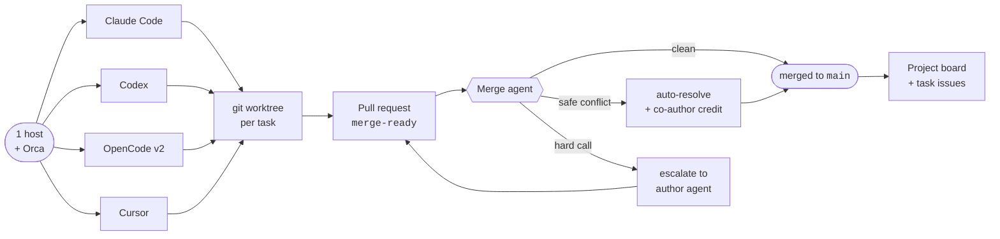
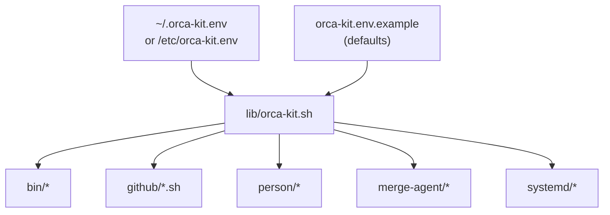
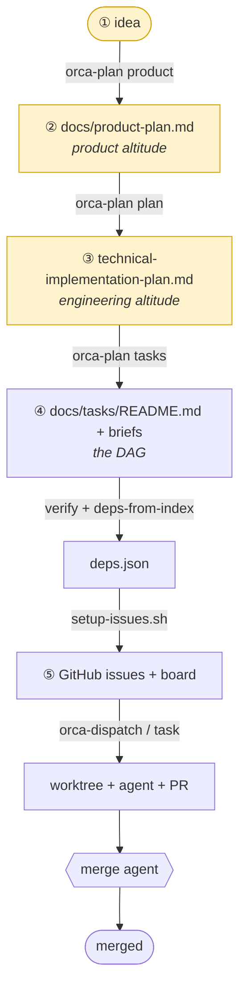
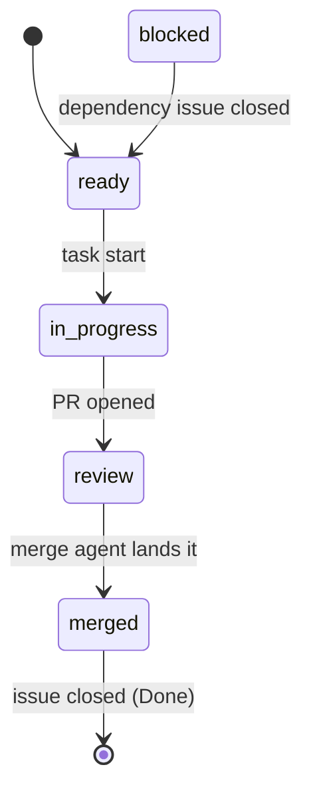
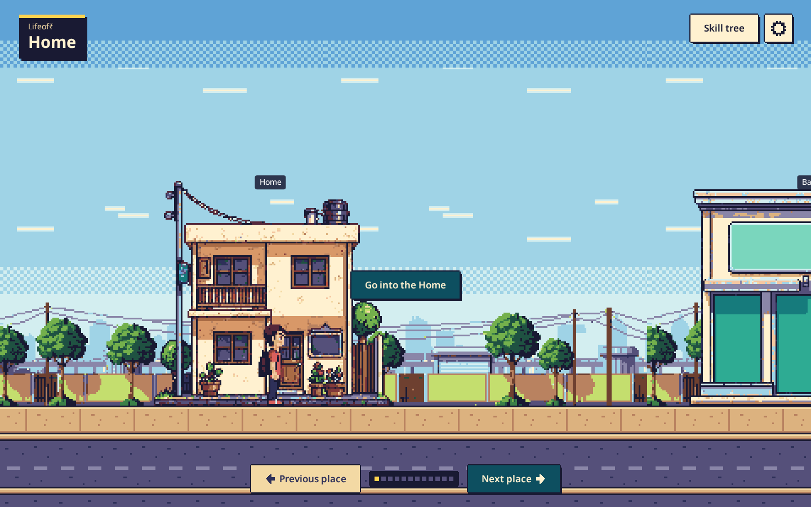
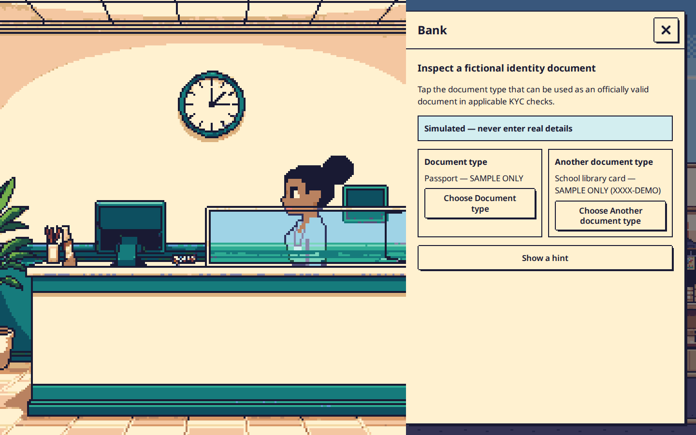
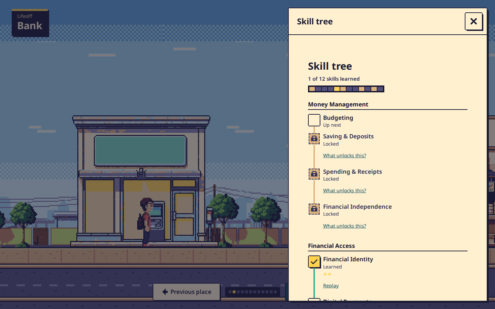
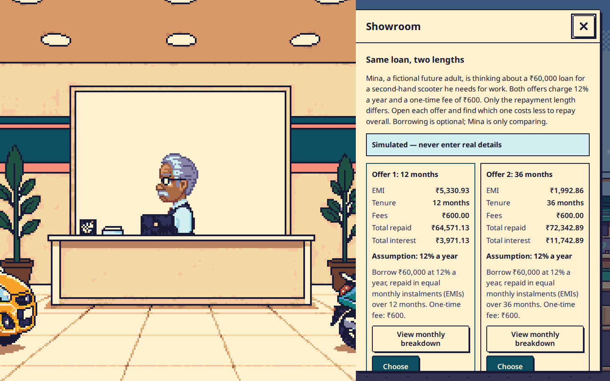
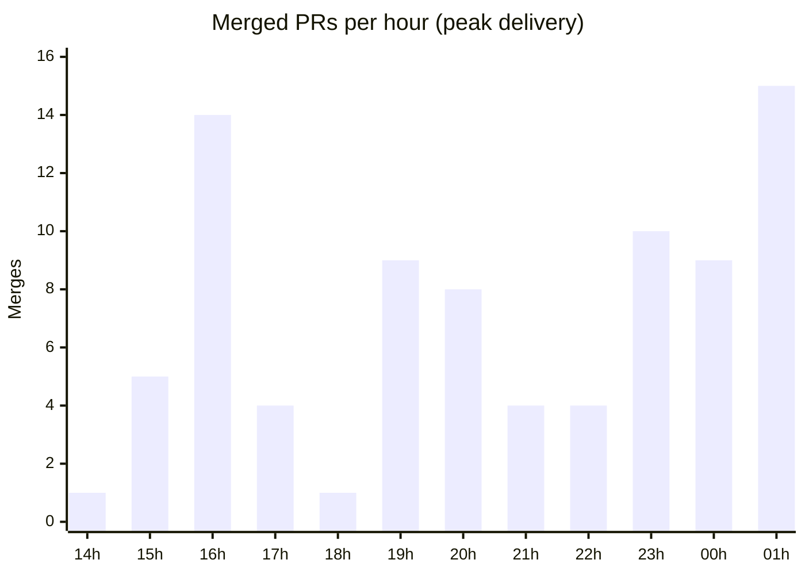

# Orca Hackathon Kit

**A reusable, self-hosted multi-agent coding workspace** — with an automated merge agent and a
spec-driven workflow that keeps parallel agents from drifting.

<!-- badges -->


> One host runs Orca and a fleet of coding agents.
> Each task gets its own git worktree → work lands through PRs → a background **merge agent**
> serializes merges, resolves safe conflicts (crediting combined authors), and escalates the hard
> questions to the agents that wrote the code.
> A shared GitHub Project board tracks features and decisions.

---

## 🧭 Contents

- [Getting started in 60 seconds](#-getting-started-in-60-seconds)
- [The idea in one picture](#-the-idea-in-one-picture)
- [Quickstart](#-quickstart)
- [Configuration (no hardcoded paths)](#-configuration-no-hardcoded-paths)
- [The pipeline: idea → plan → tasks → issues → board](#-the-pipeline-idea--plan--tasks--issues--board)
- [Day-to-day](#-day-to-day)
- [Documentation](#-documentation)
- [Templates](#-templates--copy-into-your-repo)
- [Repository layout](#-repository-layout)
- [Proven at scale](#-proven-at-scale)
- [License](#license)

---

## ⏱ Getting started in 60 seconds

```bash
# 1. clone the kit
git clone https://github.com/JAGUARAVI/orca-kit.git ~/orca-kit && cd ~/orca-kit

# 2. configure ONE file (nothing else is hardcoded)
cp orca-kit.env.example ~/.orca-kit.env        # edit KIT_OWNER / MODEL / GH

# 3. put the CLIs on your PATH
export PATH="$HOME/orca-kit/bin:$PATH"

# 4. apply the kit to a repo (new, or an existing local checkout)
./setup-existing-repo.sh /path/to/your/repo    # or: ./setup-new-repo.sh <owner/repo>

# 5. scaffold the planning pipeline and run a task
cd /path/to/your/repo
orca-plan init "My Project"                    # PRODUCT-PLAN / SPEC / AGENTS / docs/tasks
task status                                    # ready / in-progress / review / blocked
orca-dispatch P0-01 --agent claude             # brief -> worktree + agent + linked issue
```

> **Prefer to let an agent do it?** Point any coding agent at the one-URL onboarding:
> `Read https://raw.githubusercontent.com/JAGUARAVI/orca-kit/main/AGENTS.md and follow it.`

**Prerequisites:** `git`, `gh` (authenticated), [Orca](https://orca.dev) runtime, and at least one
agent CLI (Claude Code, Codex, OpenCode, or Cursor). See **[`GUIDE.md`](GUIDE.md)** for provisioning.

---

## 🖼 The idea in one picture



**Why it exists:** agent fleets don't fail because the model is weak — they fail because *parallel
work collides*. This kit makes collision cheap: disjoint ownership, frozen interfaces, one worktree
per task, and a merge agent that lands the result.

---

## 🤖 For coding agents (one URL)
This repo ships an **[`AGENTS.md`](AGENTS.md)** — the open, tool-agnostic standard (60k+ projects;
read by Claude Code, Codex, OpenCode, Cursor, Gemini, Copilot, and more). Point any agent at it and
it can install and operate the kit by itself:

```text
Read https://raw.githubusercontent.com/JAGUARAVI/orca-kit/main/AGENTS.md and follow it to set up and operate this kit.
```

That single URL is the whole handoff: the agent detects state, configures the one env file, installs
into a repo, runs the plan → tasks → issues pipeline, and follows the working rules. See
**[`docs/28-agent-readable-guide.md`](docs/28-agent-readable-guide.md)** for how this works and how
to override it per repo.

---

## ⚡ Quickstart

### New repo (clone + configure + CI)
```bash
./setup-new-repo.sh <owner/repo> [base_branch] [local_dir]
```

### Existing local repo (no clone)
```bash
./setup-existing-repo.sh <local_dir> [base_branch]
```
> Copies `AGENTS.md` + templates + docs + CI, writes the per-repo config, registers the repo in Orca,
> and — if a GitHub remote exists — creates labels, protection and the merge-agent timer.

### Full guide
> **[`GUIDE.md`](GUIDE.md)** — provisioning, per-person profiles, daily workflow, the merge agent,
> multi-repo operation, troubleshooting.

---

## ⚙️ Configuration (no hardcoded paths)

Everything machine-specific lives in **one file**. Copy the example and edit:

```bash
cp orca-kit.env.example ~/.orca-kit.env
```

```bash
KIT_HOME=~              # sibling trees (orca-docs, orca-merge, orca-keys, …)
KIT_OWNER=me            # default owner for `.orca-owner` fallbacks / routing
MODEL=<provider/model>
GH=gh                   # or a <Name>-gh wrapper
REPO_SLUG=<owner/repo>  # else discovered from `git remote origin`
```



Every script sources `lib/orca-kit.sh`, which loads that file and fills any gap with computed
defaults — so the kit runs with **no config** on a single-user machine and scales to a team.

> **Placeholders used throughout:** `<owner>` · `<owner/repo>` · `<Name>` · `<PHASE>` (P0/P1/…) ·
> `<ID>` · `<repo-dir>`. Worked examples that name a specific repo are labelled *example*.

---

## 🧵 The pipeline: idea → plan → tasks → issues → board

Each stage is a different altitude, and each is reviewed by a human before the next begins.



```bash
orca-plan init "My Project"                 # scaffold PRODUCT-PLAN / SPEC / AGENTS / docs/tasks
orca-plan all docs/idea.md                  # idea → product plan → tech plan → task DAG (review each)

# …or stage by stage:
orca-plan product docs/idea.md              # idea    → docs/product-plan.md
orca-plan plan                              # product → docs/technical-implementation-plan.md
orca-plan tasks --phases P0 P1 P2           # tech    → index table + one brief per task
orca-plan verify                            # validate graph; flag shared ownership

github/deps-from-index.py docs/tasks/README.md -o docs/tasks/deps.json
github/setup-issues.sh <owner/repo> --deps docs/tasks/deps.json --phases P0 P1 P2 --gh <Owner>-gh
```

> 📖 Full walkthrough: **[`docs/23-idea-to-task-dag.md`](docs/23-idea-to-task-dag.md)** ·
> issue/board tooling: **[`github/README.md`](github/README.md)**

---

## 🔁 Day-to-day

```bash
task status                      # ready / in-progress / review / blocked
task next --phase P1 --n 3       # the next unblocked tasks
task start P1-08 --agent claude  # worktree + agent + linked issue, label in-progress
task done  P1-08                 # close the issue after the PR merges

orca-dispatch P0-04 --agent claude   # brief → worktree + agent + linked issue
```



---

## 📚 Documentation

28 pages, each at one altitude. Start at **[`docs/00-index.md`](docs/00-index.md)** — every page is linked below.

| # | Doc |
|---|---|
| 01 | [Architecture](docs/01-architecture.md) |
| 02 | [Hosts & access](docs/02-hosts-and-access.md) |
| 03 | [Agents](docs/03-agents.md) |
| 04 | [OpenCode + DeepSeek-V4.1-Flash on Fireworks (Microsoft Foundry)](docs/04-opencode-foundry.md) |
| 05 | [Per-person profiles (Plan B)](docs/05-per-person-keys.md) |
| 06 | [Automated merge agent](docs/06-merge-agent.md) |
| 07 | [Security](docs/07-security.md) |
| 08 | [Runbook](docs/08-runbook.md) |
| 09 | [Troubleshooting](docs/09-troubleshooting.md) |
| 10 | [Task / decision board](docs/10-board-and-agents.md) |
| 11 | [Porting to another repository](docs/11-porting-to-a-new-repo.md) |
| 12 | [Per-person GitHub auth](docs/12-per-person-github-auth.md) |
| 13 | [Orca features & maximum-productivity patterns](docs/13-orca-features.md) |
| 14 | [Specs, architecture & guardrails (stopping agents from doing random things)](docs/14-specs-and-architecture.md) |
| 15 | [Dividing work & delegating to agents](docs/15-work-division-and-delegation.md) |
| 16 | [Agent playbook (how agents should behave in this repo)](docs/16-agent-playbook.md) |
| 17 | [Conventions, glossary & FAQ](docs/17-faq-and-conventions.md) |
| 18 | [Google Antigravity CLI (`agy`) as an agent](docs/18-antigravity-agent.md) |
| 19 | [Turning a plan into tasks, issues and a board](docs/19-task-breakdown-and-issues.md) |
| 20 | [Ponytail (agent ruleset: write the least code that works)](docs/20-ponytail.md) |
| 21 | [Run CI on the VM (self-hosted Actions runner)](docs/21-self-hosted-runner.md) |
| 22 | [Agentic workflow efficiency (automations that cut real waste)](docs/22-efficiency-automations.md) |
| 23 | [Idea → product plan → technical plan → parallel task DAG (the whole pipeline)](docs/23-idea-to-task-dag.md) |
| 24 | [Agent skills (what the agents can do, and how to add more)](docs/24-agent-skills.md) |
| 25 | [Pooling individual Claude/Codex accounts with TeamClaude](docs/25-teamclaude-account-pooling.md) |
| 26 | [Case study: shipping a 59-task product with 5 people and a fleet of agents](docs/26-case-study.md) |
| 27 | [Supporting more agents in Orca](docs/27-adding-agents.md) |
| 28 | [The agent-readable guide (one URL onboarding)](docs/28-agent-readable-guide.md) |

---

## 🧩 Templates — copy into your repo

`PRODUCT-PLAN.md` · `SPEC.md` · `ADR.md` · `AGENTS.md` · `TASKS-README.md` · `TASK-BRIEF.md`

---

## 🗂 Repository layout

```
orca-kit/
├── setup-new-repo.sh          # bootstrap a repository
├── setup-existing-repo.sh     # retrofit a local repo
├── lib/orca-kit.sh            # loads config; sourced by every script
├── orca-kit.env.example       # one config file for the whole kit
│
├── bin/                       # the daily drivers
│   ├── orca-plan              # idea → product plan → tech plan → task DAG
│   ├── orca-dispatch          # brief → worktree + agent + issue
│   ├── task                   # status / next / start / done / sync
│   └── orca-reap              # remove merged / abandoned worktrees
│
├── github/                    # issue + tracking toolchain
│   ├── setup-issues.sh        # labels → milestones → issues → auto-unblock Action
│   ├── create-task-issues.py  ·  deps-from-index.py  ·  reconcile-task-issues.py
│   ├── task-reconcile.yml  ·  task-sync.yml  ·  board-sync.sh  ·  ci.yml
│   └── issue-templates/       # Task · Bug · Human-gate issue forms
│
├── merge-agent/               # orca-merge-agent (draft guard + backoff), resolve, author-respond
├── person/                    # orca-keys-add · orca-gh-add · orca-route · orca-route-*
├── systemd/                   # merge-agent units · runner-bootstrap.sh · runner-health@.*
├── skills/                    # merge-agent · task-workflow · orca-kit  (+ install.sh)
├── docs/                      # 26 pages (see above)
├── templates/                 # PRODUCT-PLAN · SPEC · ADR · AGENTS · TASKS-README · TASK-BRIEF
└── welcome/                   # team-facing: WELCOME · PLAYBOOK · SUMMARY · INVITE
```

---

## 📈 Proven at scale

Extracted from a real weekend run — **Life of Rupee**, a financial-literacy game built for the
Megathon. See the full write-up (with screenshots and art) in
**[`docs/26-case-study.md`](docs/26-case-study.md)**.

| Home street | Lesson (bank) | Skill tree | Loan offers |
|---|---|---|---|
|  |  |  |  |

| Metric | Value |
|---|---|
| People | **5** — 46 / 17 / 14 / 12 / 9 PRs each |
| Build window | **~15 hours** (first commit → last merge) |
| Merged PRs | **98** (~2.7 per person-hour) |
| Code | **+54,668 / −1,667** lines · 1,372 files |
| Commits on `main` | 114 · **67 with `Co-authored-by` credit** |
| Tasks | **59 briefs** (P0 23 · P1 14 · P2 22) → 74 issues |
| Merge agent | 101 PRs · 65 armed · **8 conflicts** resolved · **3 escalated** |
| PR cycle | p50 **5.6 min** · p90 37.6 min |



> **What kept it safe:** disjoint ownership + frozen interfaces → only **8 of 101** PRs conflicted.
> **What hurt:** CI capacity (runners) and quota — not the model. Both are now first-class in the kit
> (docs 21, 22, 25).

---

## 📄 License

MIT — see [LICENSE](LICENSE).