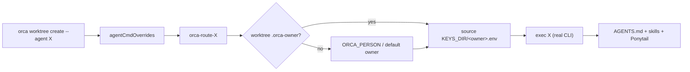

# 27 — Supporting more agents in Orca

Orca is agent-agnostic: any TUI agent can be launched in a worktree. This doc covers how Orca
selects agents, how to add a new one to the kit's per-person routing, and how to give it the same
guardrails (env, skills, rules) as the built-in ones.

## How Orca picks an agent

| Mechanism | What it does |
|---|---|
| `orca worktree create --agent <id>` | launches a **known** agent in the worktree's first terminal |
| `orca terminal create --worktree active --command "<cmd>"` | launches **any** CLI in the current worktree |
| Orca → Settings → Agents | registers a host-owned agent entry (custom argv, model, effort) |
| `agentCmdOverrides` | re-maps an agent id to a specific command (this is how per-person routing is wired) |

Known ids Orca recognises out of the box include **`claude`, `codex`, `omp`, `pi`, `grok`, `gemini`**,
plus `opencode`/`opencode2` and others for installed TUIs. If the installed CLI rejects `--agent`,
fall back to `terminal create --command`.

```bash
# known agent, first terminal, with a prompt
orca worktree create --name feat-x --agent codex --prompt "<task brief>" --json

# any agent / custom argv (model, effort, flags Orca's launcher doesn't expose)
orca terminal create --worktree active --command 'codex --model <m> -c model_reasoning_effort="high"' --json
orca terminal send --terminal <handle> --text "<task brief>"
```

> Prefer `--agent` when the built-in launcher is enough (it puts the agent in the first terminal, no
> fallback shell). Use `terminal create --command` only when you need arbitrary argv.
> Wait for readiness with `orca terminal wait --for tui-idle --timeout-ms <n>` before sending work.

## Adding a new agent to the kit (the full loop)

Adding an agent is four small pieces. The kit's per-person model (doc 05) makes them uniform.

### 1. Per-person wrapper — `<Name>-<agent>`
`person/orca-keys-add` already creates wrappers for `opencode2`, `claude`, `codex`, `cursor`.
Add a line for a new agent (e.g. `gemini`, `aider`, `goose`):

```bash
# in person/orca-keys-add, extend the loop:
for pair in "opencode2:opencode2" "claude:claude" "codex:codex" "cursor:cursor-agent" \
            "gemini:gemini" "aider:aider" "goose:goose"; do
  w="${pair%%:*}"; b="${pair##*:}"
  cat > "$LB/${name}-${w}" <<WRAP
#!/usr/bin/env bash
set -euo pipefail
set -a; . "$K/$name.env"; set +a
[ -f "$K/$name.opencode.json" ] && export OPENCODE_CONFIG="$K/$name.opencode.json"
exec $b "\$@"
WRAP
  chmod +x "$LB/${name}-${w}"
done
```

The wrapper's only job: source that person's env (keys, `GH_CONFIG_DIR`, git identity) then exec
the real binary. Name it `<Owner>-<agent>` so routing is predictable.

### 2. Routing wrapper — `orca-route-<agent>`
So Orca-launched agents use the **worktree owner's** keys automatically:

```bash
cp person/orca-route-claude person/orca-route-<agent>   # edit the agent name inside
# or, equivalently:
cat > person/orca-route-<agent> <<'W'
#!/usr/bin/env bash
set -euo pipefail
here="$(cd "$(dirname "$0")" && pwd)"
route="$here/orca-route"; [ -x "$route" ] || route="$(command -v orca-route)"
exec "$route" <agent> "$@"
W
chmod +x person/orca-route-<agent>
```

`orca-route` resolves the owner (`<worktree>/.orca-owner` → `$ORCA_PERSON` → default), sources
`$KEYS_DIR/<owner>.env`, and execs the agent. Works for any agent — no code changes.

### 3. Register the override in Orca
Point Orca's agent id at the routing wrapper so the built-in launcher routes per person:

```bash
# Orca → Settings → Agents: set the agent's command to ~/bin/orca-route-<agent>
# or set agentCmdOverrides in Orca's config (host-owned)
```
Then `orca worktree create --agent <id>` launches through the wrapper and inherits the owner's
identity. Verify with `orca agent-context --json` (the machine-readable command schema).

### 4. Give it the same guardrails
Agents behave consistently only if they share the rules and skills:
- **Rules:** put the non-negotiables in the repo's `AGENTS.md` (auto-read by most CLIs at the repo
  root). Agents that read `CLAUDE.md`/`.cursor/rules`/`GEMINI.md` instead should symlink to it.
- **Skills:** install the kit skills globally so the new agent sees them —
  `skills/install.sh` copies to `~/.agents/skills` and symlinks OpenCode/Claude; add that agent's
  skills dir if it differs (e.g. `~/.gemini/skills`).
- **Ponytail** (least-code ruleset): each agent installs it its own way — see `docs/20-ponytail.md`.
- **Hooks / status:** if the agent has lifecycle hooks (Claude/Codex/Cursor do), wire the kit's
  status hook so it appears in the Orca pane; see the agent's own hook config.



## Verify a new agent
```bash
# 1) the raw CLI works
<agent> --version

# 2) the per-person wrapper sources the right identity
<Owner>-<agent> --version ; echo "$GH_CONFIG_DIR"

# 3) routing picks the owner
echo <Owner> > <worktree>/.orca-owner
orca-route-<agent> --version        # should exit 0

# 4) through Orca
orca worktree create --name agent-smoke --agent <id> --prompt "reply PONG" --json
orca terminal list --worktree active --json   # find the handle
orca terminal read --terminal <handle> --limit 200 --json
```

## Notes / pitfalls
- **Don't double-launch.** `--agent` already owns the first terminal — don't `terminal create` the
  same agent again; a bare create adds a fallback shell first.
- **Handles are runtime-scoped.** After an Orca restart you get `terminal_handle_stale`; re-list and
  continue with the replacement. Never dual-send to old and new handles.
- **`--agent` has no per-call flags** for model/effort/args. When you need those, use
  `terminal create --command '<agent> --model … -c …'`.
- **Config homes differ.** Some agents isolate cleanly via a config dir (`CLAUDE_CONFIG_DIR`,
  `CODEX_HOME`); others need an isolated `HOME` (Antigravity). Put whichever applies in the person's
  env file — never in a global config.
- **`opencode2` needs `--standalone`** (doc 05) or it attaches to the keyless background service;
  other agents have their own equivalents. Bake the correct default into the wrapper.
- **One agent per worktree task.** The kit's contract is one task = one worktree = one agent = one
  PR (doc 15); adding agents shouldn't change that shape.