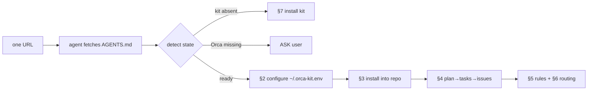

# 28 — The agent-readable guide (one URL onboarding)

The kit ships an **[`AGENTS.md`](../AGENTS.md)** at the repo root: an agent-readable setup guide.
This doc explains the convention, why it works, and how to point agents at it.

## What `AGENTS.md` is
`AGENTS.md` is an **open, tool-agnostic standard** — a "README for agents": the build steps, tests,
conventions and constraints an AI coding agent needs. It is supported by 60k+ projects and read
natively by Claude Code, OpenAI Codex, Google Jules/Gemini CLI, Cursor, GitHub Copilot, Zed, Warp,
Aider, goose, OpenCode and more. There's no required schema — plain Markdown at the repo root.

- Spec / examples: <https://agents.md/>
- It complements `README.md` (humans). Keep the README human-facing; put agent detail in `AGENTS.md`.
- **Nested files are supported:** the closest `AGENTS.md` to the edited code wins (monorepos), and an
  explicit user instruction overrides both.

## The one-URL onboarding
An agent with web/file access can bootstrap from a single line. Paste this into any agent:

```text
Read https://raw.githubusercontent.com/JAGUARAVI/orca-kit/main/AGENTS.md and follow it to set up and operate this kit.
```

Why this is enough: the guide is written **for an agent**, in order, and is *self-branching* — it
begins by detecting the environment (is the kit present? is Orca installed? is `gh` available?) and
tells the agent exactly where to go next. It also encodes the working rules and the hard-stop
conditions, so the agent does not have to be re-briefed.



## How to make the same file work across tools
Most CLIs read `AGENTS.md` directly. A few look for their own filename — point them at it with a
symlink so there is **one source of truth**:

```bash
ln -sf AGENTS.md CLAUDE.md                          # Claude Code
ln -sf AGENTS.md .cursor/rules.md                   # Cursor (or .cursorrules)
ln -sf AGENTS.md .github/copilot-instructions.md    # GitHub Copilot
ln -sf AGENTS.md GEMINI.md                          # Gemini CLI
```
(These are for the *target repo's* rules. The kit's own root `AGENTS.md` is the onboarding guide.)

## Two different `AGENTS.md`s — don't confuse them
| File | Audience | Purpose |
|---|---|---|
| `orca-kit/AGENTS.md` (root) | an agent setting up the kit | **onboarding**: detect → configure → install → operate |
| `orca-kit/templates/AGENTS.md` | an agent working in a *project* that used the kit | **rules**: scope, DoD, ask-vs-proceed, authorship |

`setup-new-repo.sh` / `setup-existing-repo.sh` copy the **template** into your repo; the root file is
what you hand to an agent to install the kit.

## Per-repo override
When the kit is applied to a repo, that repo gets its own `AGENTS.md` (from the template) with
project-specific rules. If both exist, the **closest** file wins — the repo's own rules govern work
inside it, and the kit root guide governs setup. Keep project rules in the project; keep the
onboarding guide in the kit.

## What the guide guarantees
The onboarding `AGENTS.md` instructs the agent to:
- **never hardcode paths** — configure one env file and source `lib/orca-kit.sh`;
- **stop and ask** at defined points (missing runtime, overwriting plans, out-of-scope requests);
- **never print/commit secrets or access links**;
- **follow the work contract** (one task = one worktree = one agent = one PR; don't merge your own PR).

## Verify onboarding worked
Ask the agent to run the detection block from §1 and report the four markers
(`KIT_PRESENT`, `ORCA_OK`, `GH_OK`, resolved `$KIT_HOME/$MERGE_DIR/$MODEL/$GH`). If all match, the
agent has loaded the guide correctly.

## Notes
- Prefer the **raw** URL (`raw.githubusercontent.com/...`) for fetching; the GitHub blob URL renders
  HTML around the Markdown.
- Pin a tag/commit (`.../main/AGENTS.md` → `.../<sha>/AGENTS.md`) if you need reproducibility.
- The standard is governed by the Agentic AI Foundation (Linux Foundation); the format is stable but
  intentionally minimal — add headings freely.